# سند (Sanad)

رفيق يومي للسكينة والتحصين، ودليل جهات ومستشارين **موثّق إدارياً**، مجاني بالكامل: برامج أذكار وآيات بمصادرها، رقية مكتوبة ومسموعة، مذكّرة مشفّرة على الجهاز، حجز وتواصل إداري، إحالة آمنة، ومكتبة صوتية.
سند **لا تشخّص ولا تعالج ولا تعد بنتيجة**. هي طبقة توثيق ووساطة وحجز وإحالة، ورفيق للذكر والطمأنينة.

> نطاق أكاديمي/MVP ببيانات اصطناعية. لا إطلاق فعلي قبل اجتياز بوابات `references/08-testing-deployment-roadmap.md` §8.5.

**التوثيق كاملاً:** [خريطة التوثيق](docs/README.md) — لكل ملف ما يشرحه، ولمن، وهل ما زال مطابقاً للكود.

## لمحة

**الويب** (`frontend/`)

<table>
  <tr>
    <td>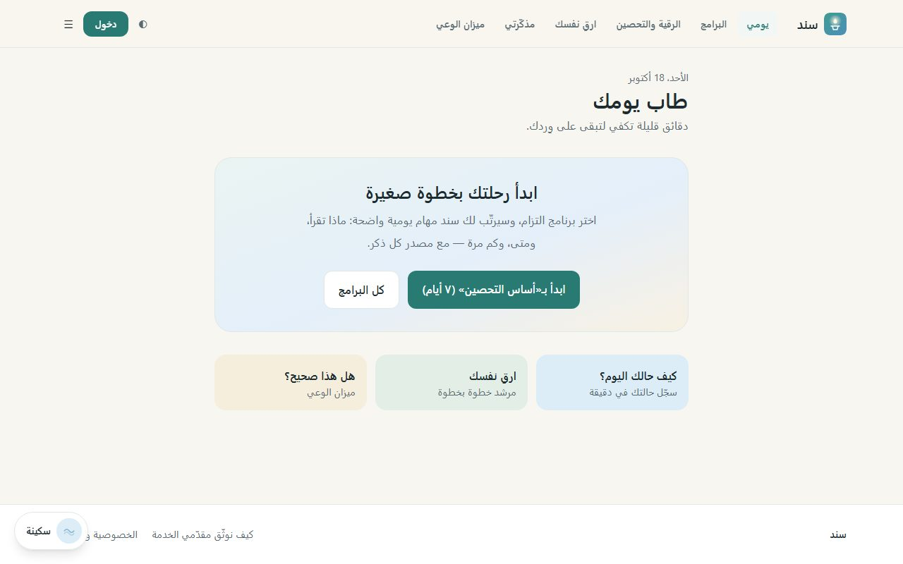</td>
    <td>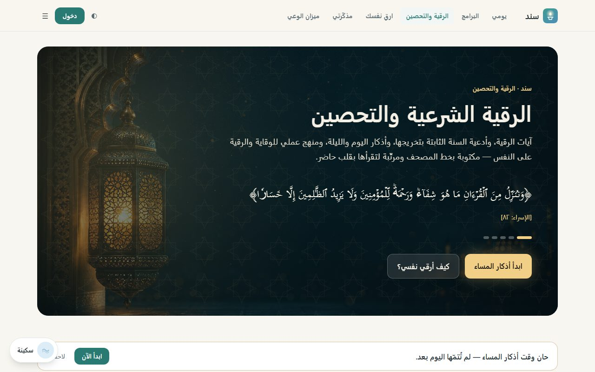</td>
  </tr>
  <tr>
    <td align="center">يومي</td>
    <td align="center">الرقية الشرعية والتحصين</td>
  </tr>
  <tr>
    <td>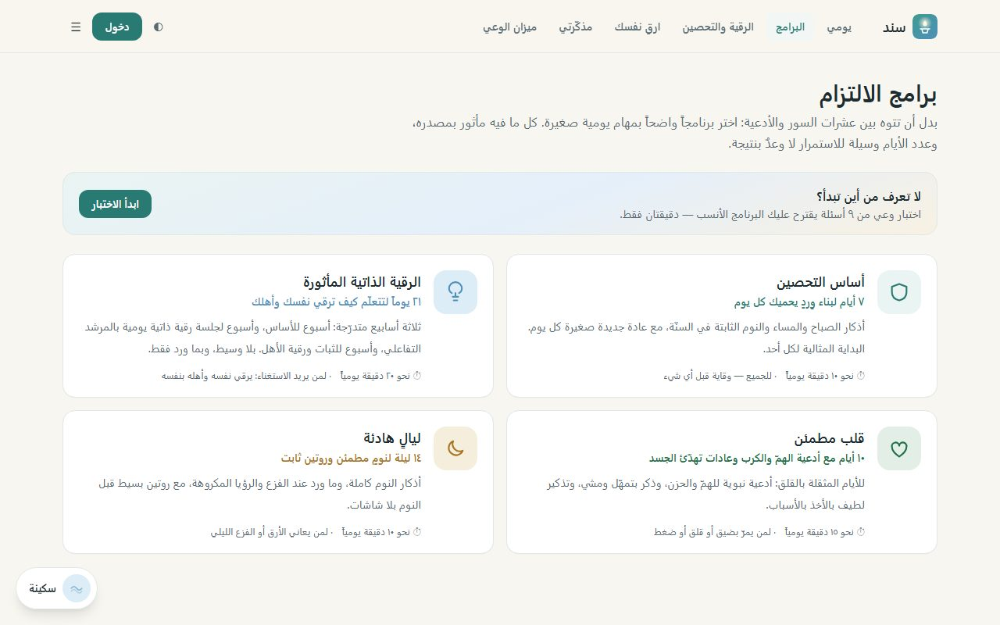</td>
    <td>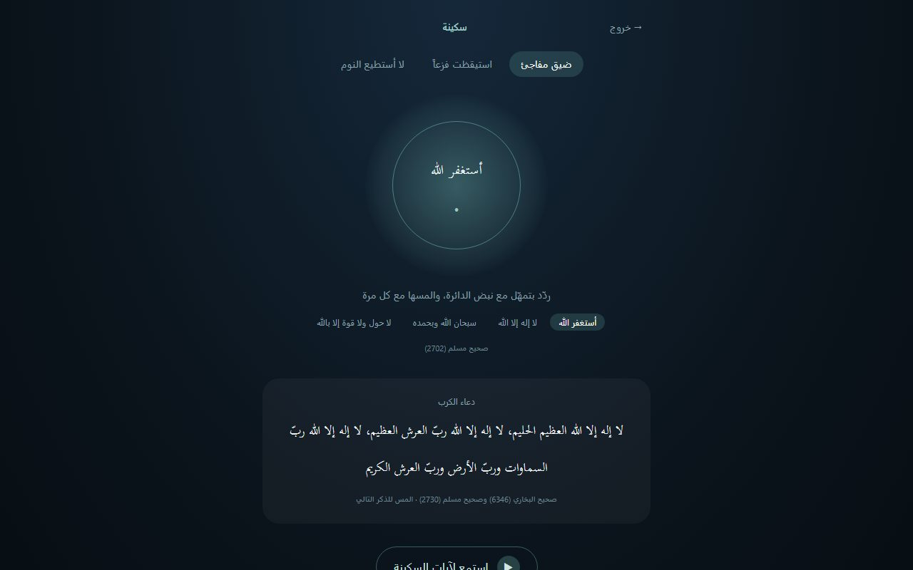</td>
  </tr>
  <tr>
    <td align="center">برامج الالتزام</td>
    <td align="center">السكينة</td>
  </tr>
</table>

**تطبيق الجوال** (`mobile_flutter/`) بواجهة الويب نفسها

<table>
  <tr>
    <td>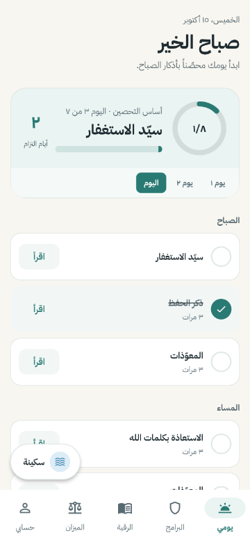</td>
    <td>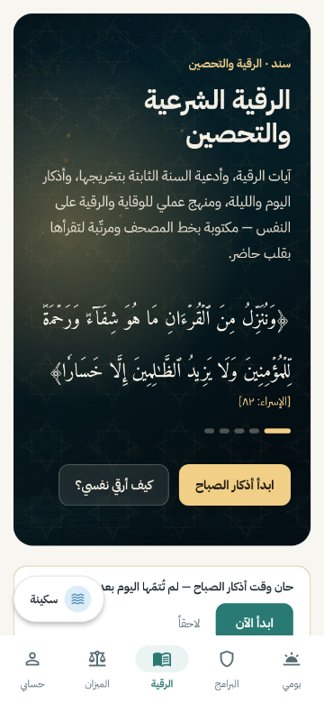</td>
    <td>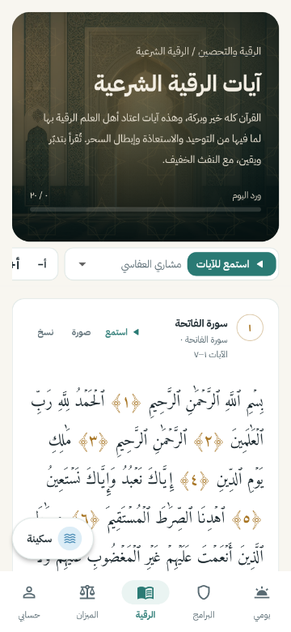</td>
    <td>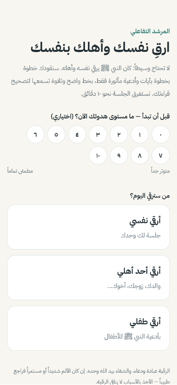</td>
  </tr>
  <tr>
    <td align="center">يومي</td>
    <td align="center">الرقية والتحصين</td>
    <td align="center">الورد بالتلاوة</td>
    <td align="center">ارقِ نفسك</td>
  </tr>
  <tr>
    <td>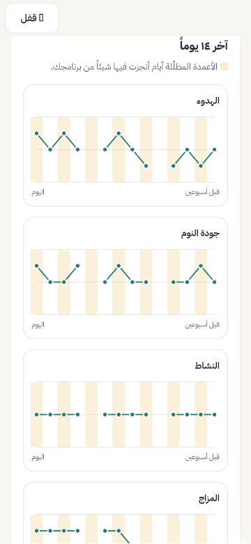</td>
    <td>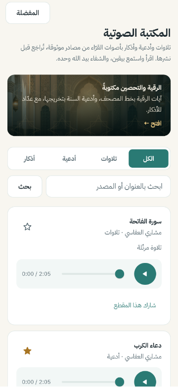</td>
    <td>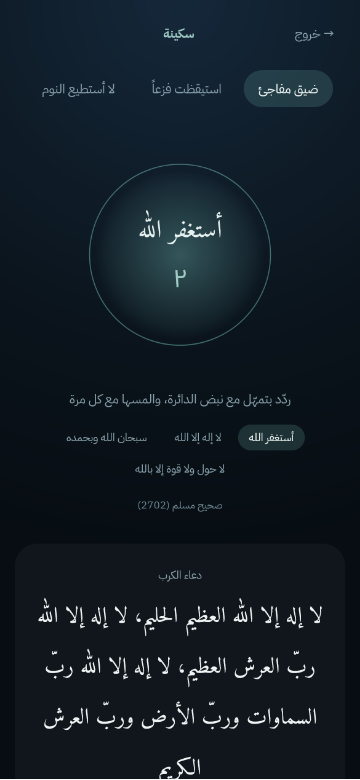</td>
    <td>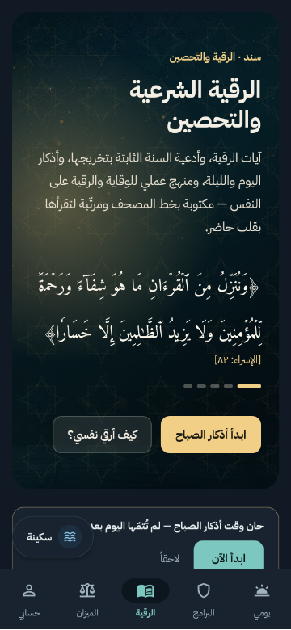</td>
  </tr>
  <tr>
    <td align="center">مذكّرتي</td>
    <td align="center">المكتبة الصوتية</td>
    <td align="center">السكينة</td>
    <td align="center">الوضع الليلي</td>
  </tr>
</table>

الصور تُعاد بأمر واحد بعد أي تغيير بصري: [خريطة التوثيق — صور التطبيق](docs/README.md#صور-التطبيق).

## البنية

| المجلد | ما فيه | توثيقه |
|---|---|---|
| `src/Sanad.Domain` | الكيانات والقواعد، بلا أي اعتماد خارجي | [ADR-0001](docs/adr/0001-architecture-and-adr-process.md) |
| `src/Sanad.Application` | أوامر/استعلامات MediatR + Pipeline (تحقق، صلاحيات، Idempotency، تدقيق، إحالة عاجلة) | `references/03` |
| `src/Sanad.Infrastructure` | EF Core (PostgreSQL/SQLite)، Identity + JWT + 2FA، تشفير AES-GCM، Outbox، SignalR، تخزين | `references/04` |
| `src/Sanad.Api` | Minimal APIs، Policies، Middleware أمني، OpenAPI | `references/05` |
| `tests/` | Domain / Application / Api.IntegrationTests | [الاختبارات](#الاختبارات) |
| `frontend/` | الويب: React 18 + TypeScript + Vite + Tailwind، عربي RTL، Framer Motion | [ADR-0014](docs/adr/0014-frontend-client-and-session.md)، [ADR-0022](docs/adr/0022-local-first-daily-companion.md) |
| `mobile_flutter/` | تطبيق الجوال بـ Flutter (Android وiOS)، يصل محتواه وألوانه من الويب آلياً | [README](mobile_flutter/README.md)، [ADR-0023](docs/adr/0023-mobile-app-flutter.md) |
| `packages/shared/` | المحتوى والمنطق المشترك (المصحف، الأذكار، البرامج، عميل الـ API) ومولّدات Dart ومتجهات التطابق | [ADR-0023](docs/adr/0023-mobile-app-flutter.md) |
| `ruqyah-app/` | «سند» للرقية الذاتية: PWA محلية أولاً، وحساب اختياري للمزامنة والختمة الجماعية | [README](ruqyah-app/README.md)، [ADR-0021](docs/adr/0021-self-ruqyah-companion-app.md) |
| `tools/Sanad.LibraryImport/` | استيراد مقاطع المكتبة الصوتية دفعة واحدة | [README](tools/Sanad.LibraryImport/README.md) |
| `docs/adr/` | سجلّ قرارات المعمارية (23 قراراً) | [الفهرس](docs/README.md#سجلّ-القرارات-adr) |
| `references/` | الحزمة المرجعية الأصلية؛ قرارات ADR تحكمها عند التعارض | [الخريطة](docs/README.md#الحزمة-المرجعية-الأصلية-references) |

## التشغيل المحلي (Windows)

المتطلبات: .NET SDK 9، وNode 22، وFlutter 3.44 لتطبيق الجوال. لا حاجة لـ Docker: التطوير يعمل على SQLite وذاكرة محلية بدل Redis.

```powershell
# 1) الأسرار المحلية (مفاتيح عشوائية + المدير الأول) — تُطبع كلمة المرور المؤقتة للمدير
powershell -ExecutionPolicy Bypass -File scripts/setup-dev.ps1

# 2) الـ API على http://localhost:5080 (Swagger: /swagger)
$env:ASPNETCORE_ENVIRONMENT="Development"; dotnet run --project src/Sanad.Api --urls http://localhost:5080

# 3) الويب على http://localhost:5173
cd frontend; npm install; npm run dev

# 4) تطبيق الجوال (Flutter) على محاكي أندرويد — 10.0.2.2 هو حاسوبك من داخل المحاكي
cd mobile_flutter; flutter pub get; flutter run --dart-define=SANAD_API_BASE=http://10.0.2.2:5080

# 5) تطبيق «سند» للرقية الذاتية (اختياري) على http://localhost:5174
cd ruqyah-app; copy .env.example .env.local; npm install; npm run dev
```

ميزات رفيق السكينة في الويب والجوال تعمل **بلا خادم**؛ الخادم لازم للحساب والحجز والمكتبة والتلاوات.

### الدخول

- **المستفيد:** Google على الويب والجوال، وSign in with Apple على iOS. لا بريد ولا هاتف (ADR-0023).
- **حسابات العرض** (تُنشأ تلقائياً في Development، كلمة المرور `Demo-Pass-123`): من `/staff/login` — ورابطه ظاهر في صفحة الدخول في بيئة التطوير فقط.
  `beneficiary@sanad.local` (مستفيد)، `sheikh@sanad.local` (راقٍ شرعي).
- **المدير الأول:** `admin@sanad.local` بكلمة المرور المؤقتة من الخطوة 1، من `/staff/login`. عند أول دخول يُفرض تغيير كلمة المرور وإعداد تطبيق مصادقة (2FA). بعدها يمنح المدير أدوار المنسق ومدير المحتوى من «الإدارة ← الأدوار».

رمز OTP للهاتف في التطوير يُطبع في سجل الـ API. لا يوجد مزود SMS حقيقي، وذلك مقصود (ADR-0011).

## الاختبارات

```powershell
dotnet test                                          # Domain + Application + تكامل على الـ API الحقيقي
cd frontend; npm test; npm run lint; npm run typecheck; npm run build
cd packages/shared; npm test; npm run check:pure     # نص القرآن مطابق، ولا اعتمادات خارجية، ومتجهات التطابق
node packages/shared/scripts/export-dart.mjs --check # محتوى Flutter مطابق لمصدره المشترك
node frontend/scripts/export-tokens.mjs --check      # ألوان Flutter وصور المشاهد مطابقة للويب
cd mobile_flutter; flutter analyze; flutter test --exclude-tags screenshot
cd mobile_flutter; flutter test --tags screenshot    # لقطات المراجعة (‎--update-goldens لتحديثها بعد مراجعتها)
cd ruqyah-app; npm run check:guardrails; npm run typecheck; npm test; npm run build
npx playwright test                                  # E2E (Chrome وFirefox وWebKit) — يتطلب تشغيل الـ API والويب أولاً، ويعمل في CI تلقائياً
```

اختبار هجرات PostgreSQL عبر Testcontainers يُفعَّل بـ `SANAD_TEST_POSTGRES=1` (يحتاج Docker، ومفعّل في CI).
كل ما سبق يعمل في CI (`.github/workflows/ci.yml`) بعد فحص الأسرار (gitleaks) وفحص غياب أي كود دفع.

## الإنتاج

- `Database:Provider=Postgres`. الهجرات: `dotnet tool run dotnet-ef database update -p src/Sanad.Infrastructure -s src/Sanad.Api`.
- الأسرار عبر Key Vault (`KeyVault:Uri`). **الإقلاع يُرفض** إن غاب مفتاح التشفير أو مفتاح JWT أو تطابقا، أو إن عُطّل CAPTCHA، أو استُخدم SQLite (`StartupGuards`).
- **Redis وتخزين S3 إلزاميان في الإنتاج** (Cache، إبطال الرموز، Backplane لـ SignalR؛ والملفات مشتركة بين النسخ والصوت عبر CDN)،
  إلا لنشر بنسخة واحدة مع `Deployment:SingleInstance=true`. المهام الخلفية تعمل على نسخة واحدة بقفل PostgreSQL — راجع ADR-0020.
- تطبيق الجوال: إعدادات البناء والدخول الأصلي (معرّفات Google، Sign in with Apple) في [mobile_flutter/README.md](mobile_flutter/README.md).

## الضوابط غير القابلة للتفاوض (مطبّقة ومختبرة)

نطاق شرعي فقط: لا محتوى طبي ولا إحالة طوارئ (ADR-0024) · لا تشخيص ولا تصنيف لحالة المستفيد · فلتر يرفض وعد الشفاء المضمون والجزم بفك السحر أو العين وضمان النتيجة على كل نص عام وعلى التوصية · تشفير الملاحظات والتوصيات والرسائل · فصل تام بين الملاحظة الخاصة والتوصية · لا أي كود دفع (فحص آلي في CI) · الهوية منفصلة عن الاعتماد المهني · 2FA إلزامي لكل دور إداري.

## رفيق السكينة اليومي على الويب

ميزات تعمل بلا حساب، ومحلية على الجهاز بالكامل (ADR-0022)، ولها نظائرها في تطبيق الجوال:

| المسار | الميزة |
|---|---|
| `/today` | يومي: مهام البرنامج حسب الوقت، تقدّم، أيام التزام، تذكير يومي |
| `/programs` | برامج الالتزام (٧ / ١٠ / ١٤ / ٢١ يوماً): أذكار وآيات مأثورة بمصادرها |
| `/ruqyah` | الرقية الشرعية والتحصين: الآيات والأدعية بتخريجها، تلاوة بأصوات القرّاء، وعدّاد للورد |
| `/self-ruqyah` | المرشد التفاعلي للرقية الذاتية (لنفسي / لأهلي / لطفلي) بتلاوة وتكرار |
| `/journal` | مذكّرتي: متابعة الحالة مشفّرة محلياً (رمز + بصمة WebAuthn PRF) ورسم ١٤ يوماً |
| `/awareness`، `/awareness/quiz` | ميزان الوعي (هل هذا صحيح شرعاً؟) واختبار «اختبر وعيك» |
| `/sakina` | السكينة: ذكر بتمهّل وآيات بصوت هادئ، يعمل دون إنترنت |
| `/privacy-mode` | الوضع المتحفّظ، الخروج السريع، مسح البيانات المحلية |

النص القرآني من المصحف المدقّق المشترك (`packages/shared/src/content/quran.ts`، يُولَّد بـ `frontend/scripts/gen-quran.py`). التموضع والتسويق في `docs/growth/positioning.md`.
